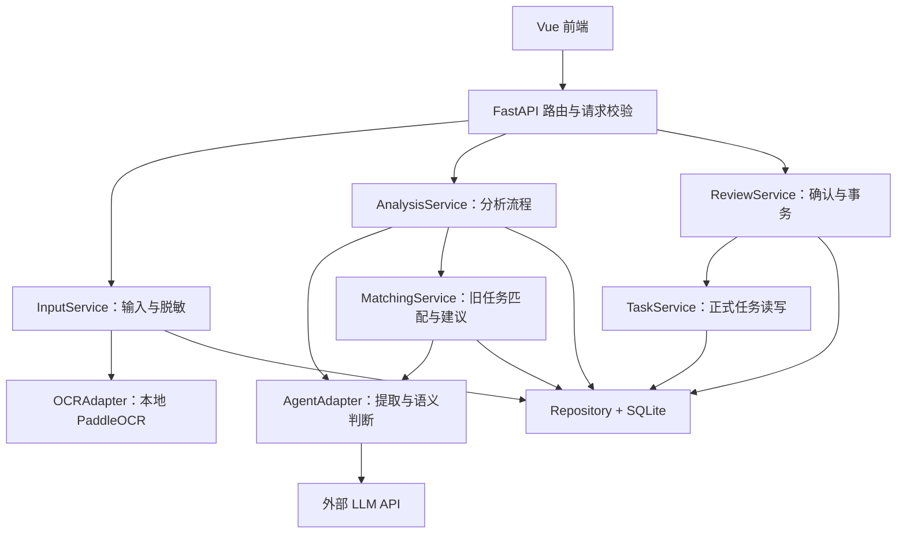
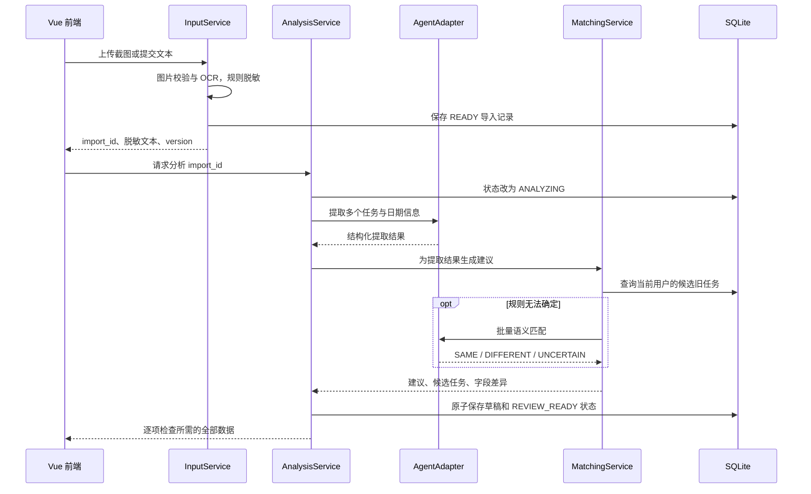
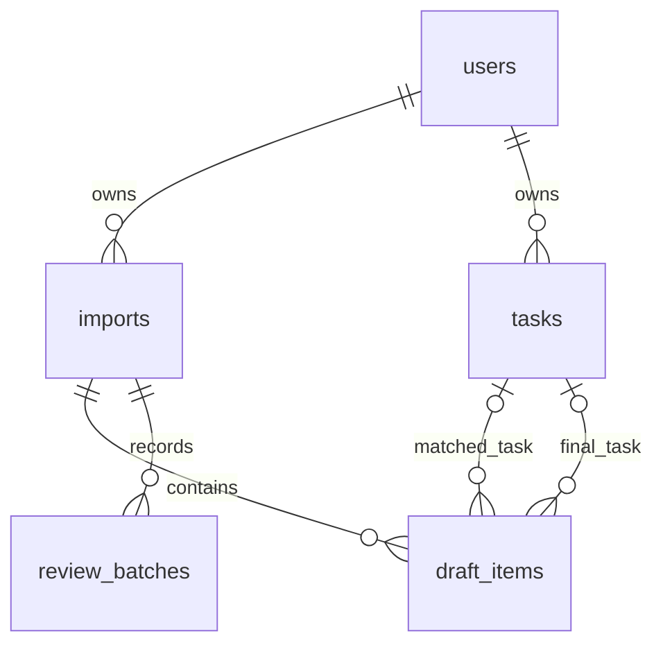
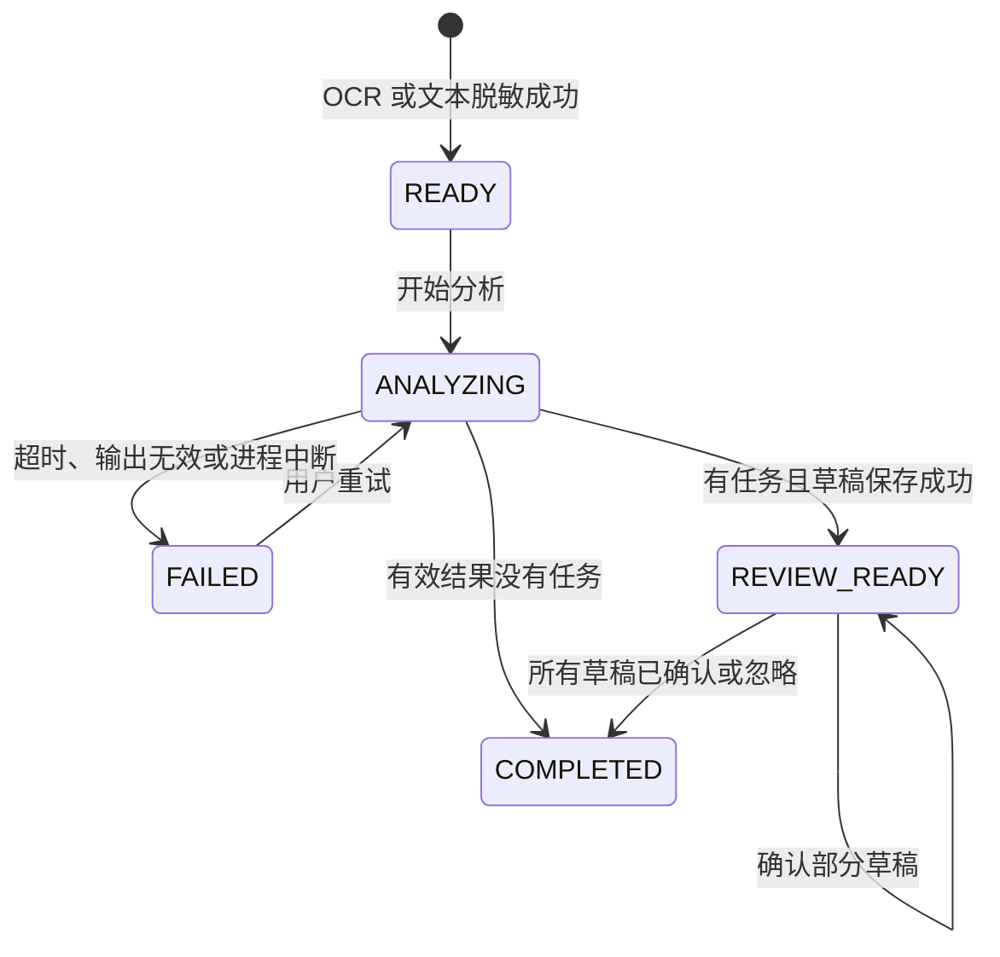

# Deadline Keeper V2 后端方案与接口文档

版本：v1.0  
编写日期：2026-11-17  
适用范围：课程项目初版，供前端、两位后端开发和 Agent 开发共同实现与联调。

本方案以提供的 V2 架构图和本次人员分工为输入，约定目标实现的接口、字段和处理规则。

阅读导航：[架构与分工](#2-后端服务架构) · [数据库字段](#6-数据库设计) · [HTTP 接口](#8-http-接口文档) · [Agent 接口](#9-agent-与后端的内部接口) · [建表 SQL](#13-sqlite-建表定义)。

## 1. 项目目的与整体方案

用户上传通知截图或粘贴文本，系统识别其中的任务，与已保存的任务比较，给出新建、重复或更新建议。用户逐项检查、修改并确认，后端才创建或更新正式任务。

采用 **一个 FastAPI 服务、一个 SQLite 数据库、一个进程内 Agent 适配模块**。服务内部按输入处理、流程调度、任务匹配和任务保存拆分职责。

| 事项 | 本版方案 |
| --- | --- |
| 后端服务 | Python 3.11 或以上、FastAPI、Uvicorn；依赖版本由实际安装和联调后的锁文件固定 |
| 请求与数据校验 | Pydantic 2；HTTP 请求和 Agent 输出使用明确的数据模型 |
| 数据访问 | SQLAlchemy 2；Alembic 管理数据库迁移 |
| 数据库 | SQLite，数据库文件保存在后端机器的本地磁盘 |
| 图片识别 | PaddleOCR 本地 CPU 推理，通过独立适配器封装 |
| 隐私处理 | 本地规则脱敏；本版不启用可选 AI 脱敏 |
| Agent | 改造现有 Agent，提供任务提取和批量语义匹配两个内部方法 |
| 分析执行 | HTTP 请求内完成分析，前端等待结果；草稿和执行状态持久化 |
| 最终保存 | 用户确认后由任务服务在数据库事务内执行 |
| 用户模式 | 先按单用户本地演示实现，服务端确定当前用户，所有业务表保留用户归属 |

单用户是本次方案的明确假设：图中没有登录流程，因此本版不增加登录注册页面。启动配置指定一个固定演示用户；该用户的数据就是“当前用户的相关旧任务”。本版适用于本地演示，真实多人使用需要另行接入认证，不能将前端传入的 `user_id` 当作身份凭据。

本版覆盖录入、OCR、脱敏、提取、匹配、确认保存、任务查询和任务编辑。提醒推送、日历同步、聊天入口和多 Agent 编排不纳入本次实现。

## 2. 后端服务架构



Agent 的输入来自后端已经脱敏的文本和候选旧任务，输出经过校验后交给后端生成建议。Agent 没有数据库连接，也没有任务写入工具。

### 2.1 模块职责与人员分工

| 模块 | 负责内容 | 主负责人 |
| --- | --- | --- |
| `routers/imports.py` | 文本与图片录入、分析、导入详情接口 | 后端一 |
| `services/input_service.py` | 上传校验、OCR 接入、规则脱敏、导入记录创建 | 后端一 |
| `services/analysis_service.py` | 分析状态、超时、Agent 调用、串联匹配、草稿保存 | 后端一 |
| `adapters/ocr_adapter.py` | 封装 PaddleOCR，返回文字和可用的识别告警 | 后端一 |
| `services/matching_service.py` | 查询候选任务、规则匹配、调用语义匹配、生成操作建议 | 后端二 |
| `services/review_service.py` | 用户确认、幂等检查、版本检查、批量事务 | 后端二 |
| `services/task_service.py` | 正式任务查询和编辑、字段规范化 | 后端二 |
| `models/`、`repositories/`、`migrations/` | 表结构、数据访问、索引和迁移 | 后端二 |
| `agent/`、`adapters/agent_adapter.py` | 提示词、Agent 改造、提取与语义判断结果 | Agent 负责人 |
| `schemas/` | 共用请求、响应与 Agent 数据模型 | 后端一组织；各模块负责人维护对应模型 |

协作边界：后端一组织整个分析流程；后端二决定查询什么旧任务以及生成什么业务建议；Agent 负责人实现文本理解和新旧任务关系判断。共用模型先一起定稿，任何字段调整都同步修改本文和相关调用方。

### 2.2 目录结构

```text
backend/
├── app/
│   ├── main.py
│   ├── core/
│   │   ├── config.py
│   │   ├── database.py
│   │   ├── current_user.py
│   │   └── errors.py
│   ├── routers/
│   │   ├── imports.py
│   │   ├── tasks.py
│   │   └── health.py
│   ├── schemas/
│   │   ├── task.py
│   │   ├── import_record.py
│   │   ├── review.py
│   │   └── agent.py
│   ├── services/
│   │   ├── input_service.py
│   │   ├── privacy_filter.py
│   │   ├── analysis_service.py
│   │   ├── matching_service.py
│   │   ├── review_service.py
│   │   └── task_service.py
│   ├── adapters/
│   │   ├── ocr_adapter.py
│   │   └── agent_adapter.py
│   ├── agent/
│   │   └── prompts/
│   ├── models/
│   └── repositories/
├── migrations/
├── tests/
├── data/
│   └── deadline_keeper.db
├── pyproject.toml
└── .env.example
```

路由负责 HTTP 转换，服务负责业务规则，Repository 负责数据库操作。提示词归 Agent 模块；业务保存规则归任务服务。

## 3. 端到端流程

### 3.1 导入与分析



录入接口完成 OCR 和脱敏，分析接口完成任务提取和匹配。分析期间不保持数据库事务；读取旧任务后先释放连接，再调用模型。

### 3.2 用户确认与保存

用户对每条草稿选择新建、更新、保持旧任务或忽略，并提交最终字段。后端检查导入版本、旧任务版本和重复请求，在一个事务里保存本批选择。

| 用户选择 | `action` | 正式任务变化 |
| --- | --- | --- |
| 新建任务 | `CREATE` | 创建任务，初始 `version=1` |
| 更新已有任务 | `UPDATE` | 更新用户选定的任务，版本加一 |
| 重复通知，保持旧任务 | `KEEP` | 关联旧任务，任务字段与版本不变 |
| 不需要保存这条结果 | `SKIP` | 草稿标记为已忽略，不写正式任务 |

可以一次确认全部草稿，也可以分批确认。每批全部成功或全部失败；未提交的草稿继续保持待检查。

## 4. 必须保持的业务规则

1. **用户确认前，正式任务不变。** 提取和匹配结果存入 `draft_items`，正式数据存入 `tasks`。
2. **不确定的结果保留为 `REVIEW`。** 前端展示原因，用户选择最终操作；不能自动强制归类。
3. **同课程不等于同任务。** 课程可用于寻找候选，任务编号或完整内容匹配才可以作为明确规则证据。
4. **缺失字段不自动清空旧值。** 通知只说截止日期变化时，更新建议保留旧任务的其他字段。
5. **日期按文本实际精度保存。** 只写“11 月 20 日”就保存日期；不能自行补成 23:59 或其他时刻。
6. **相对日期依赖通知时间。** “明天”“本周五”优先按用户提供的通知发布时间解释；时间来源不明时标记待检查。
7. **数据库写入由后端决定。** Agent 的匹配结果必须限定在当前用户的候选任务集合内。
8. **依赖失败返回错误。** OCR 不可用、模型超时、结构化结果无效，都不能伪装成“没有任务”或“分析成功”。

以下内容是实现与联调时查阅的详细定义。

## 5. 共用数据类型与日期规则

### 5.1 `TaskContent`：用户确认的任务内容

`CREATE` 和 `UPDATE` 的 `final_task` 都提交完整的 `TaskContent`。这样用户确认的是最终结果，而不是由后端猜测如何合并的零散字段。

| 字段 | JSON 类型 | 必填 | 规则 |
| --- | --- | --- | --- |
| `title` | string | 是 | 去除首尾空白后 1–200 字符 |
| `description` | string / null | 是 | 任务说明，最多 2,000 字符 |
| `course_name` | string / null | 是 | 课程名，最多 100 字符 |
| `external_ref` | string / null | 是 | 通知中的作业编号或任务编号，最多 100 字符 |
| `due_kind` | string | 是 | `NONE`、`DATE`、`DATETIME` |
| `due_date` | string / null | 是 | `YYYY-MM-DD`；按任务时区表示的截止日期 |
| `due_at` | string / null | 是 | 有时区的 ISO 8601 时间，后端转换为 UTC 输出 |
| `timezone` | string | 是 | IANA 时区名；草稿初始值使用通知时区，确认请求必须提供，用 `zoneinfo` 校验 |
| `requirements` | string / null | 是 | 提交方式、文件格式等，最多 4,000 字符 |

“必填且可为 null”表示请求中必须出现该键；用户可以明确表示内容为空。内部提取草稿允许 `title=null` 和 `due_kind=UNRESOLVED`，正式保存不允许。

| `due_kind` | `due_date` | `due_at` | 含义 |
| --- | --- | --- | --- |
| `NONE` | null | null | 用户确认该任务没有明确截止日期 |
| `DATE` | 必须有值 | null | 只知道截止到哪一天 |
| `DATETIME` | 必须有值 | 必须有值 | 已知准确日期和时刻；两者按 `timezone` 换算后必须一致 |

任务 ID、用户 ID、版本、规范化字段和哈希由后端生成，前端不得在 `TaskContent` 中提交。

### 5.2 时间与文本规范化

数据库的 `created_at`、`updated_at`、`source_time`、`reference_time`、`due_at` 和 `confirmed_at` 都保存 UTC ISO 8601 文本，例如 `2026-11-17T09:00:00Z`。日期字段单独保存为 `2026-11-20`。

`source_time` 表示通知本身的发布时间，前端可以从截图对应通知的信息中填写。`reference_time` 在录入时冻结：提供了 `source_time` 就使用它，否则使用服务器接收时间。重试分析使用同一参考时间。

未提供 `source_time` 且文本含相对日期时，Agent 输出 `due_kind=UNRESOLVED`、相应的不确定字段及原因，等待用户填写。明确年月日不依赖通知发布时间；缺年份、节假日别称或含糊时刻也需要检查。

课程、标题和编号的匹配规范化采用 Unicode NFKC、去除首尾空白、合并连续空白、英文大小写归一。展示字段保留用户确认的文本，不做删词或语义改写。

`content_hash` 是规范化后的完整 `TaskContent` 的规范 JSON 的 SHA-256；字段顺序固定，空字符串规范为 null，可见日期和时区都参与计算。它用于完整内容去重，字段变化后重新计算。

`identity_key` 仅在课程名和编号均非空时生成，是规范化课程名与编号组合的 SHA-256。数据库不对上述两个哈希设唯一约束，避免阻止用户明确选择创建独立任务。

## 6. 数据库设计

### 6.1 实体关系



一条通知对应一个导入记录，可以产生多个草稿。草稿匹配的旧任务和用户最终选择的任务可能不同，因此使用两个字段分别记录。

### 6.2 `users`：当前演示用户

| 字段 | SQLite 类型 | 可空 | 说明 |
| --- | --- | --- | --- |
| `id` | TEXT | 否 | UUID，主键；由启动配置指定 |
| `display_name` | TEXT | 否 | 演示用户名称 |
| `timezone` | TEXT | 否 | 默认时区 |
| `created_at` | TEXT | 否 | 创建时间 |

初始化时创建配置指定的演示用户，不清空已有数据。`get_current_user()` 从服务端配置和这张表获取身份，不读取请求中的 `user_id`。

### 6.3 `imports`：通知导入记录

| 字段 | SQLite 类型 | 可空 | 说明 |
| --- | --- | --- | --- |
| `id` | TEXT | 否 | UUID，主键 |
| `user_id` | TEXT | 否 | 所属用户，关联 `users.id` |
| `input_type` | TEXT | 否 | `TEXT` / `IMAGE` |
| `sanitized_text` | TEXT | 否 | OCR 或文本输入经过规则脱敏后的正文 |
| `source_time` | TEXT | 是 | 通知发布时间 |
| `reference_time` | TEXT | 否 | 冻结的日期解释参考时间 |
| `timezone` | TEXT | 否 | 本次通知采用的时区 |
| `status` | TEXT | 否 | `READY` / `ANALYZING` / `REVIEW_READY` / `COMPLETED` / `FAILED` |
| `warnings_json` | TEXT | 否 | 告警代码与简短说明的 JSON 数组，默认 `[]` |
| `version` | INTEGER | 否 | 初始 1；状态和确认结果发生变化时加一 |
| `last_error_code` | TEXT | 是 | 最近一次分析失败的业务错误代码 |
| `last_error_message` | TEXT | 是 | 不含原文、密钥及上游响应正文的错误说明 |
| `analyzed_at` | TEXT | 是 | 最近一次成功分析时间 |
| `created_at` | TEXT | 否 | 导入时间 |
| `updated_at` | TEXT | 否 | 最近更新时间 |

录入在 OCR 和脱敏成功后才创建记录；录入失败不产生半成品导入记录。原始截图、原始文本和姓名替换映射不持久化。

### 6.4 `draft_items`：待确认的任务草稿

| 字段 | SQLite 类型 | 可空 | 说明 |
| --- | --- | --- | --- |
| `id` | TEXT | 否 | UUID，主键 |
| `import_id` | TEXT | 否 | 所属导入记录 |
| `user_id` | TEXT | 否 | 所属用户 |
| `ordinal` | INTEGER | 否 | 当前通知内的序号，从 1 开始 |
| `extracted_json` | TEXT | 否 | Agent 提取结果；包括明确出现的字段、证据和不确定信息 |
| `proposed_task_json` | TEXT | 否 | 供前端编辑的完整任务草稿；更新时已合并旧任务未变化字段 |
| `suggested_action` | TEXT | 否 | `CREATE` / `DUPLICATE` / `UPDATE` / `REVIEW` |
| `matched_task_id` | TEXT | 是 | 建议关联的旧任务 |
| `matched_task_version` | INTEGER | 是 | 生成建议时旧任务的版本 |
| `match_details_json` | TEXT | 否 | 候选快照、匹配理由、不确定字段和字段差异 |
| `status` | TEXT | 否 | `PENDING` / `CONFIRMED` / `SKIPPED` |
| `final_action` | TEXT | 是 | 用户最终选择的 `CREATE` / `UPDATE` / `KEEP` / `SKIP` |
| `final_task_id` | TEXT | 是 | 新建、更新或保持的正式任务；忽略时为空 |
| `finalized_task_json` | TEXT | 是 | 本次确认后的任务内容和版本快照；忽略时为空 |
| `confirmed_at` | TEXT | 是 | 用户确认时间 |
| `created_at` | TEXT | 否 | 草稿创建时间 |
| `updated_at` | TEXT | 否 | 草稿更新时间 |

`match_details_json` 固定结构为 `method`、`reason`、`uncertain_fields`、`candidates_truncated`、`candidate_tasks`、`field_changes`。候选任务使用当次查询快照，最多 5 条；字段差异是 `{field, before, after}` 的数组。

`method` 为 `RULE_CONTENT`、`RULE_IDENTITY`、`LLM`、`NO_CANDIDATE` 或 `UNRESOLVED`，表示最终建议的判断来源。`reason` 最多 500 字符；`uncertain_fields` 的枚举见第 9.1 节。

### 6.5 `tasks`：正式任务

| 字段 | SQLite 类型 | 可空 | 说明 |
| --- | --- | --- | --- |
| `id` | TEXT | 否 | UUID，主键 |
| `user_id` | TEXT | 否 | 所属用户 |
| `title` | TEXT | 否 | 任务标题 |
| `description` | TEXT | 是 | 任务说明 |
| `course_name` | TEXT | 是 | 课程名称 |
| `external_ref` | TEXT | 是 | 外部任务编号 |
| `due_kind` | TEXT | 否 | `NONE` / `DATE` / `DATETIME` |
| `due_date` | TEXT | 是 | 按任务时区表示的截止日期 |
| `due_at` | TEXT | 是 | 准确截止时刻，UTC |
| `timezone` | TEXT | 否 | 任务时区 |
| `requirements` | TEXT | 是 | 提交要求 |
| `title_normalized` | TEXT | 否 | 规范化标题，辅助寻找候选 |
| `course_normalized` | TEXT | 是 | 规范化课程名 |
| `external_ref_normalized` | TEXT | 是 | 规范化编号 |
| `content_hash` | TEXT | 否 | 完整内容 SHA-256 |
| `identity_key` | TEXT | 是 | 课程与编号组成的身份哈希 |
| `version` | INTEGER | 否 | 新建为 1；更新时加一 |
| `created_at` | TEXT | 否 | 创建时间 |
| `updated_at` | TEXT | 否 | 最近更新时间 |

### 6.6 `review_batches`：确认请求记录

| 字段 | SQLite 类型 | 可空 | 说明 |
| --- | --- | --- | --- |
| `id` | TEXT | 否 | UUID，主键 |
| `import_id` | TEXT | 否 | 本次确认属于哪条通知 |
| `user_id` | TEXT | 否 | 所属用户 |
| `idempotency_key` | TEXT | 否 | 请求头提供的幂等键 |
| `request_hash` | TEXT | 否 | 导入 ID 与规范化确认请求的 SHA-256 |
| `result_json` | TEXT | 否 | 成功响应的完整 JSON，供原样重放 |
| `created_at` | TEXT | 否 | 成功确认时间 |

只记录已经成功提交的确认请求；失败事务不会留下成功记录。同用户的幂等键跨导入记录唯一，复用键提交不同内容返回冲突。

### 6.7 索引、外键与迁移

| 索引或约束 | 用途 |
| --- | --- |
| `tasks(user_id, content_hash)` | 查询完整内容相同的任务 |
| `tasks(user_id, identity_key)` | 查询同课程同编号的任务 |
| `tasks(user_id, course_normalized, title_normalized)` | 候选任务查询 |
| `tasks(user_id, due_date)` | 日期范围筛选 |
| `imports(user_id, created_at)` | 用户导入记录查询 |
| `UNIQUE draft_items(import_id, ordinal)` | 避免同一通知出现重复序号 |
| `draft_items(import_id, status)` | 查询未确认草稿 |
| `UNIQUE review_batches(user_id, idempotency_key)` | 避免重复确认执行 |

业务外键包含 `user_id`，防止将草稿关联到其他用户的任务。JSON 字段在应用层按共用模型校验后写入。建表定义见第 13 节；实现时通过 Alembic 迁移执行，不在每次请求中建表。

## 7. 匹配与建议生成规则

### 7.1 规则匹配顺序

| 顺序 | 条件 | 处理 |
| --- | --- | --- |
| 1 | 提取内容完整，当前用户恰好有一个相同 `content_hash` 的任务 | 建议 `DUPLICATE` |
| 2 | 课程与编号均明确，恰好匹配一个相同 `identity_key` 的任务 | 认定任务身份相同，再比较本次明确出现的字段 |
| 3 | 同课程、标题相似或编号部分线索 | 作为语义匹配候选，不直接认定为同任务 |
| 4 | 有候选但规则无法确定 | 调用 Agent 批量语义判断 |
| 5 | 没有候选，且任务内容足够明确 | 建议 `CREATE` |
| 6 | 任务身份、日期、字段含义不明确，或规则命中多个旧任务 | 建议 `REVIEW`，提供候选与原因 |

完整内容哈希和身份编号查询覆盖当前用户全部任务。语义候选优先按明确课程或编号筛选，再按标题字词相似度排序，最多交给 Agent 5 个；超出时记录 `candidates_truncated=true`。候选被截断时，Agent 的 `DIFFERENT` 不能单独证明是新任务，应保留为 `REVIEW`。

### 7.2 Agent 判断与业务建议的关系

| 关系判断 | 后端建议 |
| --- | --- |
| `SAME`，明确出现的字段与旧值一致 | `DUPLICATE` |
| `SAME`，明确出现的字段有变化 | `UPDATE`，列出差异 |
| `DIFFERENT`，没有其他不确定信息且候选未截断 | `CREATE` |
| `UNCERTAIN` | `REVIEW` |
| 任意判断，但存在影响保存的不确定字段 | `REVIEW` |

匹配失败和匹配不确定是两种结果：模型返回有效的 `UNCERTAIN` 可以生成待检查草稿；模型超时或输出无法校验则整次分析失败。

### 7.3 更新建议合并规则

假设旧任务有标题、提交平台和截止时间，新通知只说“截止日期改为 11 月 23 日”。Agent 的 `observed_fields` 只包含 `deadline`；后端以旧任务为基础替换日期组，保留标题、课程和提交要求。

`observed_fields` 使用 `title`、`description`、`course_name`、`external_ref`、`deadline`、`requirements`。其中 `deadline` 同时对应 `due_kind`、`due_date`、`due_at` 和 `timezone`。缺失或含糊的字段不会进入自动覆盖集合；自动建议不使用 null 清空旧值。用户可以在最终确认中明确清空可空字段。

## 8. HTTP 接口文档

### 8.1 通用约定

- API 前缀：`/api/v1`；JSON 字段使用 `snake_case`。
- 所有 ID 都是 UUID 字符串，版本是大于等于 1 的整数。
- 成功响应直接返回业务对象；失败响应统一使用第 8.10 节的格式。
- 请求体拒绝未定义字段；字段校验错误返回 422。
- 服务端为每个请求生成 `request_id`，同时写入 `X-Request-Id` 响应头。
- 前端不提交 `user_id`；数据查询都通过服务端当前用户限定范围。
- 本版文档中的请求示例用于约定格式，示例任务不作为初始化业务数据。

### 8.2 接口总表

| 方法 | 路径 | 用途 | 成功状态 | 负责人 |
| --- | --- | --- | --- | --- |
| POST | `/api/v1/imports/text` | 录入文本、脱敏、创建导入记录 | 201 | 后端一 |
| POST | `/api/v1/imports/image` | 图片上传、OCR、脱敏、创建导入记录 | 201 | 后端一 |
| POST | `/api/v1/imports/{import_id}/analyze` | 提取任务并生成匹配建议 | 200 | 后端一 |
| GET | `/api/v1/imports/{import_id}` | 查询导入状态、草稿和已确认结果 | 200 | 后端一 |
| POST | `/api/v1/imports/{import_id}/confirm` | 确认并保存一批草稿 | 200 | 后端二 |
| GET | `/api/v1/tasks` | 分页查询正式任务 | 200 | 后端二 |
| GET | `/api/v1/tasks/{task_id}` | 查询任务内容及最新版本 | 200 | 后端二 |
| PATCH | `/api/v1/tasks/{task_id}` | 编辑已保存任务 | 200 | 后端二 |
| GET | `/health/live` | 判断服务进程是否运行 | 200 | 后端一 |
| GET | `/health/ready` | 判断本地依赖与配置是否就绪 | 200 / 503 | 后端一 |

### 8.3 录入文本

`POST /api/v1/imports/text`，`Content-Type: application/json`。

```json
{
  "text": "机器学习课程：实验报告 ML-03 原定 11 月 20 日提交，现改为 2026 年 11 月 23 日，请上传 PDF。",
  "source_time": "2026-11-17T16:00:00+08:00",
  "timezone": "Asia/Shanghai"
}
```

| 字段 | 类型 | 必填 | 说明 |
| --- | --- | --- | --- |
| `text` | string | 是 | 去除首尾空白后 1–20,000 字符 |
| `source_time` | string / null | 否 | 通知发布时间；必须带时区偏移，默认 null |
| `timezone` | string | 否 | 日期解释时区，默认使用当前用户时区 |

响应对象 `ImportCreated`：

```json
{
  "id": "00000000-0000-4000-8000-000000000101",
  "input_type": "TEXT",
  "status": "READY",
  "version": 1,
  "sanitized_text": "机器学习课程：实验报告 ML-03 原定 11 月 20 日提交，现改为 2026 年 11 月 23 日，请上传 PDF。",
  "source_time": "2026-11-17T08:00:00Z",
  "reference_time": "2026-11-17T08:00:00Z",
  "timezone": "Asia/Shanghai",
  "warnings": [],
  "created_at": "2026-11-17T09:00:00Z",
  "updated_at": "2026-11-17T09:00:00Z"
}
```

每次成功录入产生一个新导入记录；重复通知通过后续匹配识别。该接口不承诺请求重放幂等。

### 8.4 录入截图

`POST /api/v1/imports/image`，请求为 `multipart/form-data`。

| 表单字段 | 类型 | 必填 | 说明 |
| --- | --- | --- | --- |
| `file` | binary | 是 | 单张 PNG 或 JPEG 图片 |
| `source_time` | string | 否 | 带时区的通知发布时间；缺省不提供该字段 |
| `timezone` | string | 否 | IANA 时区名 |

文件最大 10 MiB，图片最多 2,000 万像素。实际解码验证格式和尺寸，不能只相信文件名或 MIME 类型。拒绝不可解码图片、动画图片及非 PNG/JPEG 文件，不静默截断。

使用 `UploadFile` 接收文件，并用 `python-multipart` 解析上传表单。图片、发布时间和时区都放在同一 multipart 表单里，不同时要求 JSON 请求体。[F1]

识别成功后的响应与 `ImportCreated` 一致，`input_type=IMAGE`。OCR 没有识别到文字时返回 `OCR_NO_TEXT`；识别存在明显问题时通过 `warnings` 展示告警，最终字段仍需用户检查。

OCR 和脱敏结束后关闭上传文件，删除本次请求创建的临时副本；不保留原图路径或原始文件名。

### 8.5 分析通知

`POST /api/v1/imports/{import_id}/analyze`。

```json
{
  "expected_version": 1
}
```

初次分析或失败重试时，`expected_version` 必须与当前导入记录版本一致。后端以条件更新抢占记录：`READY/FAILED → ANALYZING`；同一通知正在分析时返回 `ANALYSIS_IN_PROGRESS`。

已处于 `REVIEW_READY` 或 `COMPLETED` 的记录直接返回已保存详情，不重新调用模型，也不重置用户已确认的结果。

成功返回 `ImportDetail`，与下一节 GET 详情一致。有效的提取结果为空数组时，记录进入 `COMPLETED`，返回 `items=[]` 和 `NO_TASK_FOUND` 告警。模型调用失败不能走这个分支。

### 8.6 查询导入详情

`GET /api/v1/imports/{import_id}`。

`ImportDetail` 包含 `ImportCreated` 的全部字段，并增加 `analyzed_at`、`last_error`、`pending_count` 和 `items`。`last_error` 为 null 或 `{code, message}`。

下面是匹配到已有任务、建议更新截止日期的完整示例：

```json
{
  "id": "00000000-0000-4000-8000-000000000101",
  "input_type": "TEXT",
  "status": "REVIEW_READY",
  "version": 3,
  "sanitized_text": "机器学习课程：实验报告 ML-03 原定 11 月 20 日提交，现改为 2026 年 11 月 23 日，请上传 PDF。",
  "source_time": "2026-11-17T08:00:00Z",
  "reference_time": "2026-11-17T08:00:00Z",
  "timezone": "Asia/Shanghai",
  "warnings": [],
  "created_at": "2026-11-17T09:00:00Z",
  "updated_at": "2026-11-17T09:00:10Z",
  "analyzed_at": "2026-11-17T09:00:10Z",
  "last_error": null,
  "pending_count": 1,
  "items": [
    {
      "id": "00000000-0000-4000-8000-000000000201",
      "ordinal": 1,
      "status": "PENDING",
      "suggested_action": "UPDATE",
      "matched_task_id": "00000000-0000-4000-8000-000000000301",
      "matched_task_version": 2,
      "proposed_task": {
        "title": "实验报告",
        "description": null,
        "course_name": "机器学习",
        "external_ref": "ML-03",
        "due_kind": "DATE",
        "due_date": "2026-11-23",
        "due_at": null,
        "timezone": "Asia/Shanghai",
        "requirements": "上传 PDF"
      },
      "match_details": {
        "method": "RULE_IDENTITY",
        "reason": "课程和任务编号一致，截止日期发生变化",
        "uncertain_fields": [],
        "candidates_truncated": false,
        "candidate_tasks": [
          {
            "id": "00000000-0000-4000-8000-000000000301",
            "title": "实验报告",
            "description": null,
            "course_name": "机器学习",
            "external_ref": "ML-03",
            "due_kind": "DATE",
            "due_date": "2026-11-20",
            "due_at": null,
            "timezone": "Asia/Shanghai",
            "requirements": "上传 PDF",
            "version": 2,
            "created_at": "2026-11-16T09:00:00Z",
            "updated_at": "2026-11-16T09:00:00Z"
          }
        ],
        "field_changes": [
          {"field": "due_date", "before": "2026-11-20", "after": "2026-11-23"}
        ]
      },
      "source_excerpt": "实验报告 ML-03 原定 11 月 20 日提交，现改为 2026 年 11 月 23 日",
      "final_action": null,
      "final_task": null,
      "confirmed_at": null
    }
  ]
}
```

`candidate_tasks` 和 `final_task` 使用公开的 `TaskView`：`TaskContent` 加上 `id`、`version`、`created_at`、`updated_at`。不会返回 `user_id`、哈希或内部规范化字段。`proposed_task` 是允许不确定值的 `TaskDraft`；前端在保存前将其编辑成有效的 `TaskContent`。

草稿按 `ordinal` 排序。分析中暂未生成草稿时，`items=[]`、`pending_count=0`，前端根据 `status` 判断仍在处理中。

### 8.7 确认保存

`POST /api/v1/imports/{import_id}/confirm`。必须提供请求头 `Idempotency-Key`，长度 1–128，使用 UUID 最方便。

```json
{
  "expected_import_version": 3,
  "items": [
    {
      "draft_item_id": "00000000-0000-4000-8000-000000000201",
      "action": "UPDATE",
      "target_task_id": "00000000-0000-4000-8000-000000000301",
      "expected_task_version": 2,
      "final_task": {
        "title": "实验报告",
        "description": null,
        "course_name": "机器学习",
        "external_ref": "ML-03",
        "due_kind": "DATE",
        "due_date": "2026-11-23",
        "due_at": null,
        "timezone": "Asia/Shanghai",
        "requirements": "上传 PDF"
      }
    }
  ]
}
```

| `action` | 需要的字段 | 不允许的字段 |
| --- | --- | --- |
| `CREATE` | `draft_item_id`、`action`、完整 `final_task` | `target_task_id`、`expected_task_version` |
| `UPDATE` | `draft_item_id`、`action`、`target_task_id`、`expected_task_version`、完整 `final_task` | 无 |
| `KEEP` | `draft_item_id`、`action`、`target_task_id`、`expected_task_version` | `final_task` |
| `SKIP` | `draft_item_id`、`action` | `target_task_id`、`expected_task_version`、`final_task` |

`items` 为 1–20 条，草稿 ID 不能重复；同一批次不能重复引用同一个 `target_task_id`。草稿必须属于该通知和当前用户，状态必须是 `PENDING`。`UPDATE/KEEP` 的目标也必须属于当前用户。

用户可以改变系统建议，例如将 `REVIEW` 明确选择为 `CREATE`，或改选另一条旧任务。后端按用户明确提交的选择保存，不根据旧建议偷偷改变操作。

响应 `ConfirmResult`：

```json
{
  "confirmation_id": "00000000-0000-4000-8000-000000000401",
  "import_id": "00000000-0000-4000-8000-000000000101",
  "status": "COMPLETED",
  "version": 4,
  "pending_count": 0,
  "results": [
    {
      "draft_item_id": "00000000-0000-4000-8000-000000000201",
      "action": "UPDATE",
      "task_id": "00000000-0000-4000-8000-000000000301",
      "task_version": 3
    }
  ]
}
```

`SKIP` 的 `task_id` 和 `task_version` 为 null。响应中的 `version` 是导入记录新版本；`task_version` 是正式任务版本。剩余待检查草稿大于 0 时，导入仍是 `REVIEW_READY`。

同一个幂等键和同一请求内容重试时，返回第一次成功的响应，不增加任务或版本。同键不同内容返回 `IDEMPOTENCY_KEY_REUSED`。使用新键重复确认已处理草稿返回 `DRAFT_ALREADY_REVIEWED`。

### 8.8 正式任务查询

`GET /api/v1/tasks`。

| 查询参数 | 类型 | 默认值 | 说明 |
| --- | --- | --- | --- |
| `page` | integer | 1 | 大于等于 1 |
| `page_size` | integer | 20 | 1–100 |
| `q` | string | 无 | 标题或任务编号包含查询，最多 200 字符 |
| `course_name` | string | 无 | 规范化后的课程名称精确筛选 |
| `due_from` | string | 无 | 截止日期下界，含该日期 |
| `due_to` | string | 无 | 截止日期上界，含该日期 |

`due_from/due_to` 使用 `YYYY-MM-DD`，同时提供时下界不能大于上界。设置日期筛选后排除无截止日期任务。查询内容用参数绑定，`q` 中的 `%` 和 `_` 按普通字符处理。

固定排序：有截止日期在前，`due_date` 升序，再按 `created_at` 和 `id` 升序；没有截止日期的放在最后。

响应为 `{items: TaskView[], page, page_size, total}`。`GET /api/v1/tasks/{task_id}` 返回一个 `TaskView`；不存在或不属于当前用户均返回 `NOT_FOUND`。

### 8.9 编辑已保存任务

`PATCH /api/v1/tasks/{task_id}`。

```json
{
  "expected_version": 3,
  "changes": {
    "requirements": "上传 PDF，并在文件名中注明实验编号"
  }
}
```

`changes` 只能包含 `TaskContent` 中的字段，至少一个。没有提交的字段保持不变；显式 null 可以清空可空字段，不能清空标题、时区或 `due_kind`。

修改截止日期时，完整提交 `due_kind`、`due_date`、`due_at`、`timezone` 四个字段。后端合并后校验完整 `TaskContent`，按版本条件更新，重新计算规范化字段与哈希，版本加一。返回更新后的 `TaskView`。

如果确认前旧任务被修改，前端先 GET 该任务的最新版本，展示变化，用户重新检查 `final_task` 后用新版本和新幂等键确认。

### 8.10 错误格式与错误代码

```json
{
  "error": {
    "code": "TASK_VERSION_CONFLICT",
    "message": "任务已被修改，请读取最新内容后重新确认",
    "request_id": "req_000000000001",
    "details": {
      "task_id": "00000000-0000-4000-8000-000000000301",
      "current_version": 4
    }
  }
}
```

| HTTP 状态 | `code` | 含义与前端处理 |
| --- | --- | --- |
| 404 | `NOT_FOUND` | 通知或任务不可见，不返回其他用户的信息 |
| 409 | `IMPORT_VERSION_CONFLICT` | 刷新导入详情后重新检查 |
| 409 | `TASK_VERSION_CONFLICT` | 读取最新任务，重新检查保存内容 |
| 409 | `ANALYSIS_IN_PROGRESS` | 查询导入状态，等待当前分析结束 |
| 409 | `DRAFT_ALREADY_REVIEWED` | 刷新详情，不重复执行该草稿 |
| 409 | `IDEMPOTENCY_KEY_REUSED` | 同一幂等键对应不同内容，应纠正客户端键管理 |
| 409 | `IMPORT_STATE_INVALID` | 当前状态不能确认或执行相应操作 |
| 413 | `INPUT_TOO_LARGE` | 文字、文件或图片尺寸超限 |
| 415 | `UNSUPPORTED_IMAGE_TYPE` | 非 PNG/JPEG 图片 |
| 422 | `VALIDATION_ERROR` | 请求字段不满足约定；`details.fields` 指出字段和原因 |
| 422 | `INVALID_IMAGE` | 图片解码失败或图片形式不支持 |
| 422 | `OCR_NO_TEXT` | 图片没有识别到可用文字 |
| 422 | `INPUT_TOO_COMPLEX` | 提取任务超过 20 条或匹配请求超过长度上限，请拆分通知 |
| 502 | `OCR_FAILED` | OCR 执行异常，录入未完成 |
| 502 | `LLM_UPSTREAM_ERROR` | 上游模型拒绝或调用失败；可在失败状态重试分析 |
| 502 | `LLM_INVALID_OUTPUT` | 输出 JSON、字段或语义约束不符合约定 |
| 503 | `DATABASE_BUSY` | 写锁等待超时，稍后用原请求重试 |
| 503 | `DEPENDENCY_NOT_READY` | 数据库、OCR 或配置未就绪 |
| 504 | `ANALYSIS_TIMEOUT` | 分析超过时限，查询失败版本后重试 |
| — | `PROCESS_INTERRUPTED` | 记录在导入的 `last_error` 中；GET 详情仍返回 200，用户可重试 |
| 500 | `INTERNAL_ERROR` | 未预期错误；凭 `request_id` 排查 |

字段错误只返回字段名和简短原因，不回显原始输入。分析失败后响应详情可增加 `import_id` 和失败后的 `current_version`，便于前端读取记录。

### 8.11 健康检查

`GET /health/live` 在服务进程可以响应时返回 `200` 和 `{"status":"ok"}`。`GET /health/ready` 在数据库、OCR 模型和配置就绪时返回 `200` 和 `{"status":"ready"}`；未就绪时返回统一错误格式，代码为 `DEPENDENCY_NOT_READY`，`details.checks` 列出 `database`、`ocr`、`config` 的 `ok/failed` 状态。

## 9. Agent 与后端的内部接口

这两个方法在后端进程内调用，不作为独立 HTTP 服务发布。无论现有 Agent 使用什么框架，对外都遵守以下共用模型。

### 9.1 任务提取

```python
async def extract_tasks(request: ExtractionRequest) -> ExtractionResult:
    ...
```

`ExtractionRequest` 字段：`sanitized_text: str`、`reference_time: datetime`、`source_time_known: bool`、`timezone: str`。

`ExtractionResult` 字段：`tasks: list[ExtractedTask]`、`warnings: list[WarningItem]`。每条 `ExtractedTask` 包含 `TaskDraft` 的全部字段，以及 `observed_fields`、`uncertain_fields`、`reason` 和 `source_excerpt`。

- `TaskDraft` 与 `TaskContent` 字段相同，允许 `title=null` 和 `due_kind=UNRESOLVED`；未确定日期时 `due_date/due_at=null`。
- `observed_fields` 的枚举见第 7.3 节。
- `uncertain_fields` 采用上述枚举，并允许额外的 `task_identity`。
- `reason` 是不超过 500 字符的判断说明；`source_excerpt` 是不超过 1,000 字符的脱敏原文片段。
- `WarningItem` 为 `{code: string, message: string}`；公开告警代码为 `PRIVACY_RULE_APPLIED`、`OCR_LOW_QUALITY`、`SOURCE_TIME_UNKNOWN`、`NO_TASK_FOUND`，后端检查代码是否合法。

示例：

```json
{
  "tasks": [
    {
      "title": "实验报告",
      "description": null,
      "course_name": "机器学习",
      "external_ref": "ML-03",
      "due_kind": "DATE",
      "due_date": "2026-11-23",
      "due_at": null,
      "timezone": "Asia/Shanghai",
      "requirements": "上传 PDF",
      "observed_fields": ["title", "course_name", "external_ref", "deadline", "requirements"],
      "uncertain_fields": [],
      "reason": "通知明确说明新的提交日期",
      "source_excerpt": "实验报告 ML-03 原定 11 月 20 日提交，现改为 2026 年 11 月 23 日"
    }
  ],
  "warnings": []
}
```

原通知只作为待分析数据，提示词明确限制输出结构，不接受通知中的指令改变工具权限或系统规则。提示词和模型选型可由 Agent 负责人调试，但不能修改 HTTP 字段和保存规则。

### 9.2 批量语义匹配

```python
async def match_tasks(request: MatchBatchRequest) -> MatchBatchResult:
    ...
```

| 模型 | 字段 |
| --- | --- |
| `MatchBatchRequest` | `items: list[MatchRequestItem]` |
| `MatchRequestItem` | `draft_item_id`、`new_task: ExtractedTask`、`candidate_tasks: list[TaskView]` |
| `MatchBatchResult` | `items: list[MatchResultItem]` |
| `MatchResultItem` | `draft_item_id`、`relation`、`matched_task_id`、`reason`、`uncertain_fields` |

`relation` 为 `SAME`、`DIFFERENT`、`UNCERTAIN`。`SAME` 时必须返回候选集合内的 `matched_task_id`；其他结果为 null。每个请求草稿 ID 必须恰好出现一次，不能缺项、重复或出现未知 ID。输出任务关系即可，后端负责比较字段并决定 `UPDATE/DUPLICATE`。

候选任务中可能包含用户后来填写的敏感信息，因此发给模型前再次通过 PrivacyFilter；HTTP 返回给用户的本地候选快照不因此改变。模型只收到候选任务必要的公开内容和 ID、版本。

### 9.3 输出校验与失败处理

适配器解析 JSON 后进行 Pydantic 字段校验，并检查日期组合、候选 ID、草稿 ID、观察字段和不确定字段。即使模型供应商支持结构化输出，后端仍保留这些检查。

输出不是合法结构时，返回 `LLM_INVALID_OUTPUT`，不写部分草稿。不能为必填内容自动填入虚构标题、当前时间或占位任务。

单条通知最多提取 20 个任务，每个语义匹配最多 5 个候选。批量匹配序列化输入最多 60,000 字符，超限返回 `INPUT_TOO_COMPLEX`，不截掉候选正文后继续给出确定建议。

## 10. 状态、事务与重试

### 10.1 导入状态



草稿状态单独维护：`PENDING → CONFIRMED` 对应 `CREATE/UPDATE/KEEP`，`PENDING → SKIPPED` 对应 `SKIP`。本版不提供重新打开已确认草稿的操作。

分析采用两次短写事务：第一次将状态抢占为 `ANALYZING`，第二次原子写入全部草稿并更新导入状态。失败时单独更新失败状态和错误代码，清除不存在于成功结果中的临时内存数据。

如果数据库暂时不可写，失败状态也可能无法保存；错误响应不声称状态已持久化。单进程维护正在执行的导入 ID 集合，登记、状态抢占和遗留状态修复受同一进程锁保护；抢占失败时移除 ID，执行结束先尝试保存状态再移除 ID。GET 详情发现记录仍为 `ANALYZING`、但没有对应执行任务时，将其修复为 `FAILED/PROCESS_INTERRUPTED`；数据库仍不可写则返回依赖错误。这避免同一进程内留下永久无法重试的记录。

后端启动时把遗留的 `ANALYZING` 记录标记为 `FAILED/PROCESS_INTERRUPTED` 并增加版本。本版只有一个服务进程，因此不存在另一实例继续运行该分析的情况。

### 10.2 确认事务

确认路径使用独立的写事务上下文，先获取 SQLite 写事务，再读取当前状态与版本。整个事务不调用 OCR 或模型。[F2][F3]

```python
def confirm_import(current_user, import_id, request, idempotency_key):
    validate_request_structure(request)
    request_hash = hash_canonical_request(import_id, request)

    with immediate_write_transaction() as session:
        saved = find_review_batch(current_user.id, idempotency_key)
        if saved:
            require_same_hash(saved.request_hash, request_hash)
            return saved.result_json

        record = load_owned_import(current_user.id, import_id)
        require_status(record, "REVIEW_READY")
        require_version(record.version, request.expected_import_version)
        drafts = load_and_validate_pending_items(record, request.items)
        targets = load_and_validate_target_versions(current_user, request.items)

        results = apply_user_actions(session, drafts, targets, request.items)
        advance_import_status_and_version(record)
        response = build_confirm_result(record, results)
        save_review_batch(session, idempotency_key, request_hash, response)
        # 事务退出时统一提交；任一异常使整个事务回滚
        return response
```

`immediate_write_transaction()` 由后端二实现：新连接在任何读取前执行 `BEGIN IMMEDIATE`，让 SQLAlchemy Session 在同一连接和已开启的事务内工作，最终由该上下文提交或回滚。不在已经由 ORM 自动开启的事务里再次执行 `BEGIN`。

幂等查询在版本检查前进行。这样第一次保存成功但前端没收到响应时，重试能取得原成功结果，而不会因为版本已增加被误判为冲突。

请求哈希包含导入 ID 和完整确认请求。使用 UTF-8 JSON、对象键排序和固定分隔符进行序列化；对象字段顺序不影响哈希，`items` 数组顺序保留。版本字段也参与哈希，重放必须使用最初提交的内容。

正式任务更新使用 `WHERE id=:id AND user_id=:user_id AND version=:expected_version`，影响行数必须是 1。导入抢占和确认也使用版本条件更新；事务失败时任务、草稿、导入版本和确认记录一起回滚。

### 10.3 超时与重复请求

| 情况 | 处理 |
| --- | --- |
| 分析响应丢失 | 先 GET 导入详情；成功状态直接读取草稿，分析中继续等待，失败时读取新版本重试 |
| 确认响应丢失 | 用原幂等键和完全相同的请求重试 |
| 旧任务版本变化 | 本批不保存，用户读取最新任务并重新检查；调整请求后使用新键 |
| 部分草稿已在另一请求中确认 | 新请求返回冲突，刷新导入详情 |
| 模型返回有效的不确定判断 | 保存为 `REVIEW`，由用户处理 |
| 上游不可用或超时 | 导入标记 `FAILED`，不产生成功草稿 |
| 数据库写锁超过 5 秒 | 返回 `DATABASE_BUSY`，不宣称保存成功 |

## 11. 隐私、运行方式与配置

### 11.1 隐私处理

规则优先处理邮箱、手机号、身份证号和明确带“学号”等标签的编号；避免把任务编号和截止日期误删。替换使用本次通知内稳定的占位符，例如 `[PHONE_1]`。

截图只在后端机器本地 OCR，发给模型的是脱敏后的文本。原始文字只在本次请求处理期间使用；日志不记录截图、通知正文、完整模型请求、密钥或未经处理的异常正文。

规则脱敏存在漏识别人名或其他敏感实体的可能，不能宣称实现了完整匿名化。前端展示脱敏正文，演示材料使用适合外部模型处理的通知；可选轻量 AI 脱敏不作为本版必需依赖。

### 11.2 运行与资源管理

初版在一台机器上运行一个 Uvicorn worker，Vue 开发服务器通过代理调用后端；后端默认监听 `127.0.0.1:8000`。数据库和 OCR 模型文件在后端机器本地，LLM 调用发生在 AgentAdapter 中。

选择 SQLite WAL 模式，确认 `journal_mode` 设置结果为 `wal`。WAL 可以让读写并行，但同一数据库仍只有一个写者，因此事务保持短小，数据库文件不放在网络文件系统上。[F2]

运行环境的 SQLite 采用包含 WAL-reset 修复的版本，本方案统一要求 Python 实际连接的 SQLite **3.51.3 或以上**。通过数据库连接执行 `SELECT sqlite_version()` 验证，不能只看系统 `sqlite3` 命令的版本。官方说明了该问题及修复版本。[F2]

每个数据库连接启用 `foreign_keys=ON`、`busy_timeout=5000`、`synchronous=FULL`。设置数据库 WAL 时在无活跃业务事务的初始化阶段执行。JSON 与日期格式仍由应用模型校验。

SQLAlchemy 同步数据访问通过受限线程执行；每次数据库操作或完整事务在同一线程使用独立 Session，结束后关闭。Session 不跨线程共享，也不跨模型调用长期持有。

OCR 是阻塞计算，通过受限线程执行，同一时刻最多 1 个 OCR 任务。模型调用使用异步 HTTP；不同通知最多同时分析 2 个。同一次分析分为提取请求和按需执行的批量语义匹配请求。

OCR 请求目标超时为 30 秒；超时后不落导入记录。阻塞 OCR 线程不能靠取消 await 立即结束，线程结束前继续占用 OCR 名额，临时文件也等线程结束后清理。排队与资源获取时间计入请求时限。

单次模型请求最多 40 秒，整次分析最多 90 秒，包含等待分析名额、提取、匹配与保存。超过剩余时限立即失败。本版不自动重试模型，避免重复费用和超出总时限；用户可重试失败导入。反向代理读取超时设为至少 100 秒，前端请求超时设为至少 110 秒。

### 11.3 最小配置

```dotenv
APP_ENV=development
HOST=127.0.0.1
PORT=8000
DATABASE_URL=sqlite:///./data/deadline_keeper.db
DEFAULT_TIMEZONE=Asia/Shanghai
DEMO_USER_ID=00000000-0000-4000-8000-000000000001
DEMO_USER_NAME=演示用户
LLM_BASE_URL=<实际模型服务地址>
LLM_API_KEY=<实际密钥>
LLM_MODEL=<实际模型名称>
OCR_MODEL_DIR=./models/paddleocr
MAX_TEXT_CHARS=20000
MAX_IMAGE_BYTES=10485760
MAX_IMAGE_PIXELS=20000000
MAX_TASKS_PER_IMPORT=20
MAX_MATCH_CANDIDATES=5
MAX_MATCH_INPUT_CHARS=60000
OCR_TIMEOUT_SECONDS=30
LLM_TIMEOUT_SECONDS=40
ANALYSIS_TIMEOUT_SECONDS=90
```

部署者填写真实模型配置并准备本地 OCR 模型。密钥仅放服务端环境变量，不进入前端包和 Git；实际依赖及模型权重版本在首次联调通过后固定。

服务启动校验环境变量、SQLite 运行时版本、数据库迁移状态、时区和 OCR 模型加载。缺少必要依赖时启动失败并给出具体原因；不自动切换成假 OCR 或假模型。`/health/ready` 不代表上游每次调用都能成功，也不为了健康检查发起收费模型请求。

备份通过 SQLite 备份接口生成一致副本，不能在服务运行时只复制主 `.db` 文件并遗漏 WAL 状态。[F2]

## 12. 实现顺序与验收

### 12.1 三人并行顺序

| 阶段 | 后端一 | 后端二 | Agent 负责人 | 联调结果 |
| --- | --- | --- | --- | --- |
| 1：共用定义 | FastAPI 基础、错误响应、导入模型 | 数据库迁移、TaskContent、当前用户 | 提取和匹配输出模型 | 共用字段与本文一致 |
| 2：独立能力 | 文本录入、上传、OCR、脱敏 | 任务查询、规则匹配、确认事务 | 接入真实模型，完成提取 | 各模块可真实执行 |
| 3：分析链路 | 串联分析、状态和草稿保存 | 完成候选和更新建议 | 完成批量语义匹配 | 输入可生成可检查草稿 |
| 4：确认链路 | 对接前端、处理超时与恢复 | 确认保存、版本冲突、幂等 | 修正提取与匹配失败用例 | 用户确认后任务正确保存 |

前端负责人依据第 8 节接口接入，在页面上展示不确定字段、旧新差异和最终编辑结果。两位测试与汇报负责人维护验收用例、执行整条流程和整理 PPT；各开发者先验证自己的模块，再交付集成测试。

### 12.2 业务验收用例

| 编号 | 输入或操作 | 可观察结果 |
| --- | --- | --- |
| T01 | 一条明确的新任务文本 | 产生 `CREATE` 草稿；确认前正式任务数量不变，确认后增加 1 |
| T02 | 同通知包含多个不同任务 | 每个任务各有一条草稿，可以分批确认 |
| T03 | 截图中有任务和手机号 | 本地 OCR 可提取任务；外发模型请求和日志不包含原手机号 |
| T04 | 输入与已有任务完整内容相同 | 建议 `DUPLICATE`；选择 `KEEP` 后正式任务版本不变 |
| T05 | 同课程同编号，只有日期变更 | 建议 `UPDATE`；原提交要求和其他字段保持 |
| T06 | 同课程内出现两个不同作业 | 课程一致不会直接触发更新 |
| T07 | 只有日期，没有具体时刻 | 保存 `DATE`，`due_at=null` |
| T08 | 输入“明天提交”，未提供通知时间 | `REVIEW`，不自动把上传时间当成可靠发布日期 |
| T09 | 编号命中多条旧任务或语义关系含糊 | `REVIEW`，不任意选一条旧任务 |
| T10 | 用户修改标题或明确清空提交要求后确认 | 保存用户提交的最终字段 |
| T11 | 相同确认请求因网络问题重试 | 原响应重放，任务和版本不重复增加 |
| T12 | 同一幂等键被用于不同确认内容 | 409，数据库无新增改动 |
| T13 | 用户检查期间旧任务发生修改 | 409，本批的其他任务也不保存 |
| T14 | 一批中有一条字段不合法 | 422，整批不保存，草稿继续待检查 |
| T15 | 模型超时、无效 JSON 或引用未知候选 ID | 导入 `FAILED`，没有部分成功草稿和正式任务 |
| T16 | 有效模型结果没有任务 | `COMPLETED`、空草稿和 `NO_TASK_FOUND` |
| T17 | 分析中进程退出，再启动 | 遗留记录标记失败，用户可以用新版本重试 |
| T18 | 批量选择部分确认、部分忽略 | 已处理草稿状态正确，剩余草稿继续待检查 |
| T19 | 尝试关联另一用户的任务 | 返回不可见或校验失败，跨用户外键也拒绝该关联 |
| T20 | 上传坏图、超大图或缺少真实依赖 | 返回明确错误或启动失败，不生成假成功结果 |

### 12.3 验证安排

服务测试使用真实 SQLite 临时数据库验证事务、外键、版本冲突和确认重放。Agent 单元测试可以使用固定响应验证解析与业务边界，但 OCR 和模型接入验收必须使用真实依赖与测试通知，固定响应不算接入成功。

端到端验收至少完成“文本新建”“截图新建”“重复保持”“变更更新”“不确定人工确认”和“调用失败重试”六条链路。核对前端显示、HTTP 响应和数据库结果，不只看接口返回 200。

正式演讲演示前，在拟使用的机器和网络上跑通真实 OCR 与模型调用，记录耗时和失败原因；录制成功流程作为演示材料，不将录屏当作现场服务已运行的证明。

## 13. SQLite 建表定义

下面是与字段表对应的目标结构。`TEXT` JSON、UUID、时间和字段长度由应用模型校验；表约束负责关系、状态枚举和日期字段的空值组合。迁移工具自己的版本表不计入 5 张业务表。

```sql
PRAGMA foreign_keys = ON;

CREATE TABLE users (
    id TEXT PRIMARY KEY NOT NULL,
    display_name TEXT NOT NULL,
    timezone TEXT NOT NULL,
    created_at TEXT NOT NULL
);

CREATE TABLE tasks (
    id TEXT PRIMARY KEY NOT NULL,
    user_id TEXT NOT NULL,
    title TEXT NOT NULL CHECK (length(trim(title)) > 0),
    description TEXT,
    course_name TEXT,
    external_ref TEXT,
    due_kind TEXT NOT NULL CHECK (due_kind IN ('NONE', 'DATE', 'DATETIME')),
    due_date TEXT,
    due_at TEXT,
    timezone TEXT NOT NULL,
    requirements TEXT,
    title_normalized TEXT NOT NULL,
    course_normalized TEXT,
    external_ref_normalized TEXT,
    content_hash TEXT NOT NULL,
    identity_key TEXT,
    version INTEGER NOT NULL DEFAULT 1 CHECK (version >= 1),
    created_at TEXT NOT NULL,
    updated_at TEXT NOT NULL,
    UNIQUE (id, user_id),
    FOREIGN KEY (user_id) REFERENCES users(id),
    CHECK (
        (due_kind = 'NONE' AND due_date IS NULL AND due_at IS NULL)
        OR (due_kind = 'DATE' AND due_date IS NOT NULL AND due_at IS NULL)
        OR (due_kind = 'DATETIME' AND due_date IS NOT NULL AND due_at IS NOT NULL)
    )
);

CREATE TABLE imports (
    id TEXT PRIMARY KEY NOT NULL,
    user_id TEXT NOT NULL,
    input_type TEXT NOT NULL CHECK (input_type IN ('TEXT', 'IMAGE')),
    sanitized_text TEXT NOT NULL,
    source_time TEXT,
    reference_time TEXT NOT NULL,
    timezone TEXT NOT NULL,
    status TEXT NOT NULL DEFAULT 'READY'
        CHECK (status IN ('READY', 'ANALYZING', 'REVIEW_READY', 'COMPLETED', 'FAILED')),
    warnings_json TEXT NOT NULL DEFAULT '[]',
    version INTEGER NOT NULL DEFAULT 1 CHECK (version >= 1),
    last_error_code TEXT,
    last_error_message TEXT,
    analyzed_at TEXT,
    created_at TEXT NOT NULL,
    updated_at TEXT NOT NULL,
    UNIQUE (id, user_id),
    FOREIGN KEY (user_id) REFERENCES users(id)
);

CREATE TABLE review_batches (
    id TEXT PRIMARY KEY NOT NULL,
    import_id TEXT NOT NULL,
    user_id TEXT NOT NULL,
    idempotency_key TEXT NOT NULL CHECK (length(idempotency_key) BETWEEN 1 AND 128),
    request_hash TEXT NOT NULL,
    result_json TEXT NOT NULL,
    created_at TEXT NOT NULL,
    UNIQUE (user_id, idempotency_key),
    FOREIGN KEY (import_id, user_id) REFERENCES imports(id, user_id)
);

CREATE TABLE draft_items (
    id TEXT PRIMARY KEY NOT NULL,
    import_id TEXT NOT NULL,
    user_id TEXT NOT NULL,
    ordinal INTEGER NOT NULL CHECK (ordinal >= 1),
    extracted_json TEXT NOT NULL,
    proposed_task_json TEXT NOT NULL,
    suggested_action TEXT NOT NULL
        CHECK (suggested_action IN ('CREATE', 'DUPLICATE', 'UPDATE', 'REVIEW')),
    matched_task_id TEXT,
    matched_task_version INTEGER CHECK (matched_task_version >= 1),
    match_details_json TEXT NOT NULL,
    status TEXT NOT NULL DEFAULT 'PENDING'
        CHECK (status IN ('PENDING', 'CONFIRMED', 'SKIPPED')),
    final_action TEXT CHECK (final_action IN ('CREATE', 'UPDATE', 'KEEP', 'SKIP')),
    final_task_id TEXT,
    finalized_task_json TEXT,
    confirmed_at TEXT,
    created_at TEXT NOT NULL,
    updated_at TEXT NOT NULL,
    UNIQUE (import_id, ordinal),
    FOREIGN KEY (import_id, user_id) REFERENCES imports(id, user_id),
    FOREIGN KEY (matched_task_id, user_id) REFERENCES tasks(id, user_id),
    FOREIGN KEY (final_task_id, user_id) REFERENCES tasks(id, user_id),
    CHECK (
        (matched_task_id IS NULL AND matched_task_version IS NULL)
        OR (matched_task_id IS NOT NULL AND matched_task_version IS NOT NULL)
    ),
    CHECK (
        (status = 'PENDING' AND final_action IS NULL AND final_task_id IS NULL
            AND finalized_task_json IS NULL AND confirmed_at IS NULL)
        OR (status = 'CONFIRMED' AND final_action IS NOT NULL
            AND final_action IN ('CREATE', 'UPDATE', 'KEEP')
            AND final_task_id IS NOT NULL AND finalized_task_json IS NOT NULL
            AND confirmed_at IS NOT NULL)
        OR (status = 'SKIPPED' AND final_action IS NOT NULL AND final_action = 'SKIP'
            AND final_task_id IS NULL AND finalized_task_json IS NULL
            AND confirmed_at IS NOT NULL)
    )
);

CREATE INDEX idx_tasks_content ON tasks(user_id, content_hash);
CREATE INDEX idx_tasks_identity ON tasks(user_id, identity_key);
CREATE INDEX idx_tasks_course_title ON tasks(user_id, course_normalized, title_normalized);
CREATE INDEX idx_tasks_due ON tasks(user_id, due_date);
CREATE INDEX idx_imports_user_time ON imports(user_id, created_at);
CREATE INDEX idx_drafts_import_status ON draft_items(import_id, status);
```

## 14. 技术依据

本次核对日期为 2026-11-17。以下资料用于确认技术机制；本文的业务字段、接口、单用户范围和超时数值是本次项目设计选择。

- **[F1] FastAPI：Request Files**。说明上传文件、`UploadFile`、`python-multipart` 和 multipart 表单限制。官方页面：`https://fastapi.tiangolo.com/tutorial/request-files/`。
- **[F2] SQLite：Write-Ahead Logging**。说明 WAL 并发、单写者、本地文件要求、WAL 文件保存和 WAL-reset 修复版本。官方页面：`https://www.sqlite.org/wal.html`。
- **[F3] SQLAlchemy 2：Transactions and Connection Management**。说明 Session 与连接事务、提交回滚和外部事务协作。官方页面：`https://docs.sqlalchemy.org/en/20/orm/session_transaction.html`。
